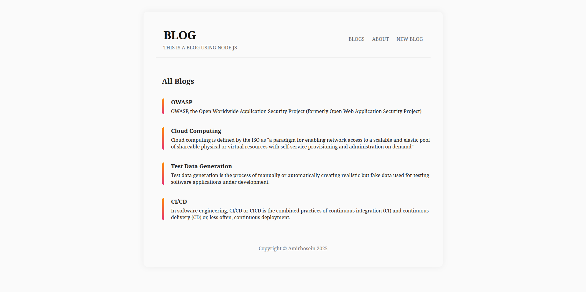
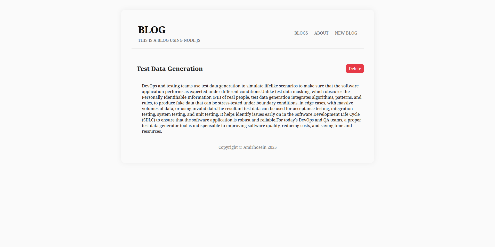
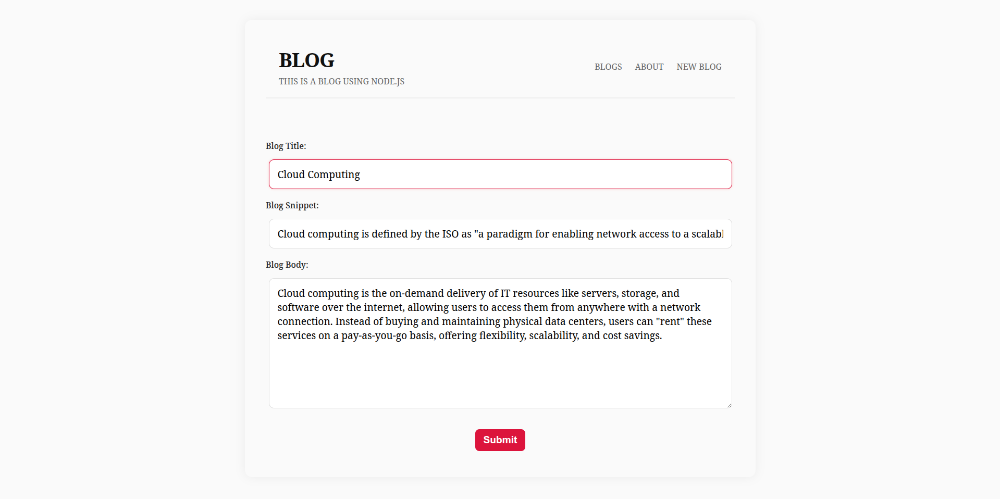
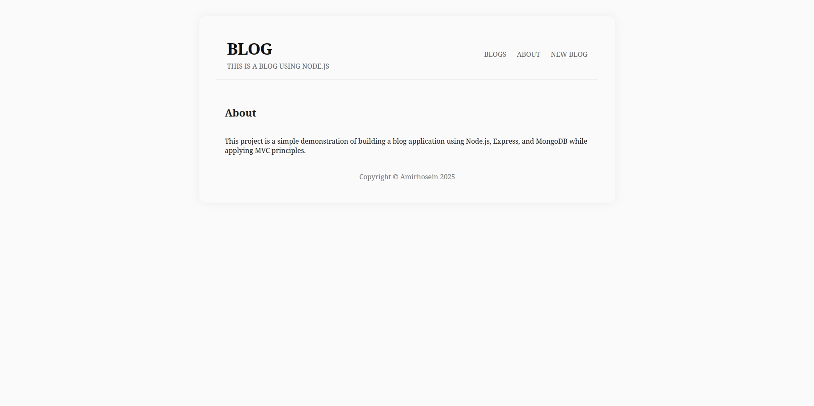

# Simple Blog

Simple Blog is a minimal personal blog application built with **Node.js**, **Express**, **MongoDB**, and **EJS**. This project focuses on core backend concepts such as routing, MVC architecture, database integration, and server-side rendering.

This project is intended for learning and practice purposes and demonstrates a clean and understandable implementation of a CRUD-based blog system.

&nbsp;

### Blog List Page



### Blog Details Page



### Create Blog Page



### About Page



&nbsp;

## Features

* Display all blog posts
* View a single blog post
* Create new blog posts
* Delete existing blog posts
* About page
* Custom 404 page


## Project Structure

The application follows the **MVC (Model–View–Controller)** pattern to keep the code organized and maintainable.

* **Models**: Define the data structure using Mongoose
* **Views**: EJS templates rendered on the server
* **Controllers**: Handle application logic and communicate between models and views
* **Routes**: Define application endpoints and map them to controllers


## Technologies Used

* Node.js
* Express.js
* MongoDB
* EJS (Embedded JavaScript Templates)
* HTML
* CSS
* JavaScript


## Server-Side Rendering with EJS

The project uses **EJS** as the view engine to render dynamic HTML pages on the server.

How it works:

* Requests are handled by Express routes
* Controllers fetch data from MongoDB using Mongoose
* Data is passed to EJS templates
* EJS generates final HTML pages that are sent to the browser

This approach is known as **server-side rendering**.

More information: [https://ejs.co](https://ejs.co)


## Database

**MongoDB** is used as the database, with **Mongoose** as the ODM.

The blog schema includes:

* title
* snippet
* body
* createdAt / updatedAt timestamps (automatically generated)

Blog posts are sorted by creation date, showing the newest posts first.


## Routes Overview

* `/blogs` – Show all blog posts
* `/blogs/create` – Create a new blog post
* `/blogs/:id` – View a single blog post
* `/about` – About page


## Setup and Installation

### Prerequisites

* Node.js
* MongoDB (local or cloud instance)

### Installation Steps

1. Clone the repository:

```bash
git clone https://github.com/amirhoseinpourmand/simple-blog.git
```

2. Navigate to the project directory:

```bash
cd blog
```

3. Install dependencies:

```bash
npm install
```

4. Configure MongoDB connection:

Update the MongoDB connection string inside `app.js`:

Create a `.env` file and add your MongoDB Atlas connection string:


5. Run the application:

```bash
node app.js
```

6. Open your browser and visit:

```
http://localhost:3000
```

---

## License

This project is licensed under the **ISC License**.


## Author

Amirhosein Pourmand
